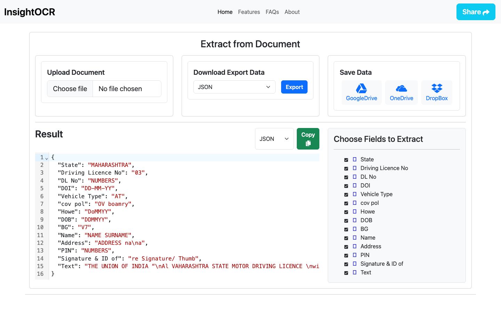
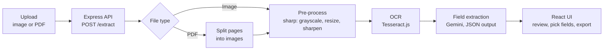

# InsightOCR

**Turn scanned documents and images into structured data.** Upload an ID card, invoice, or form as an image or PDF. InsightOCR reads the text with OCR, uses an LLM to pick out the fields, and gives you clean key-value data you can export as JSON, CSV, XML, or plain text.

**Live demo:** [insightocr.vercel.app](https://insightocr.vercel.app) (the free-tier backend can take about a minute to wake up on the first request)



## How it works



1. **Upload.** The React client sends the file to the Express API (multer, 10 MB limit by default).
2. **Pre-process.** PDFs are split into page images. Every image is converted to grayscale, resized to a fixed width, and sharpened with `sharp`, which makes OCR noticeably more accurate on phone photos and scans.
3. **OCR.** `tesseract.js` reads the text from each page.
4. **Structure.** The raw OCR text goes to Gemini with a prompt that asks for only the relevant key-value pairs, with mislabeled fields corrected. The model is told to answer in JSON (`responseMimeType: application/json`), so the result parses reliably.
5. **Review and export.** The client shows the result in a code editor and a field tree. You can switch the view between formats and export or copy the data as JSON, CSV, XML, or TXT.

Uploaded files and intermediate page images are deleted as soon as each request finishes.

## Features

- Images (JPG, PNG) and multi-page PDFs
- OCR pre-processing for better accuracy on scans and photos
- LLM-based field extraction that fixes OCR mislabels
- Field tree to browse the extracted fields
- Export to JSON, CSV, XML, or plain text, with a JSON/XML viewer
- Google Drive, OneDrive, and Dropbox buttons in the UI

## Tech stack

| Layer | Technology |
|---|---|
| Backend | Node.js, Express, multer |
| OCR | Tesseract.js, sharp, pdf-export-images |
| AI | Google Gemini (`@google/generative-ai`) |
| Frontend | React 18, React Router, React Bootstrap, CodeMirror |
| Hosting | Vercel (client), Render (API) |

## API

### `POST /extract`

`multipart/form-data` with one field, `file` (an image or PDF).

```bash
curl -F "file=@invoice.png" http://localhost:9860/extract
```

```json
{ "extractedData": "{\"Invoice No\": \"INV-1042\", \"Date\": \"12/11/2026\", \"Total Amount\": \"1450.00\"}" }
```

`extractedData` is a JSON string. Errors return `{ "error": "..." }`:

| Status | When |
|---|---|
| 400 | No file, or an unsupported file type |
| 413 | The file is larger than `MAX_FILE_SIZE_MB` |
| 422 | No text could be read from the file |
| 502 | The AI model failed or returned nothing |
| 500 | Any other processing error |

### `GET /health`

Returns `{ "status": "ok" }`.

## Run it locally

You need Node.js 18+ and a [Gemini API key](https://aistudio.google.com/apikey).

```bash
git clone https://github.com/shubhamsomwanshi11/InsightOCR.git
cd InsightOCR

# API
cd server
cp .env.example .env        # then set GEMINI_API_KEY
npm install
npm run dev                 # http://localhost:9860

# Client (in a second terminal)
cd client
npm install
REACT_APP_API_URL=http://localhost:9860 npm start   # http://localhost:3000
```

For local development, add `http://localhost:3000` to the CORS `origin` list in `server/app.mjs`.

### Configuration (`server/.env`)

| Variable | Required | Default | Purpose |
|---|---|---|---|
| `GEMINI_API_KEY` | Yes | | Google Gemini API key |
| `GEMINI_MODEL` | No | `gemini-flash-latest` | Gemini model used for field extraction |
| `MAX_FILE_SIZE_MB` | No | `10` | Upload size limit |
| `PORT` | No | `9860` | API port |

## Project structure

```
InsightOCR/
├── client/                     React app
│   └── src/
│       ├── pages/              Home, Extract
│       └── components/         upload, result viewer, field tree, export handlers, cloud pickers
└── server/                     Express API
    ├── app.mjs                 routes, upload handling, Gemini call
    └── controllers/
        ├── imageController.mjs image pre-processing + OCR
        └── pdfController.mjs   PDF to images + OCR
```

## Limitations and next steps

- OCR is configured for English text.
- Requests are processed synchronously. Large multi-page PDFs would be better served by a job queue.
- The login and register pages are UI only; there is no user account backend yet.
- The field checkboxes don't filter the export yet.
- Planned: per-document-type templates (ID card, invoice, receipt), confidence scores per field, and automated tests for the API.

## Author

**Shubham Somwanshi**: [GitHub](https://github.com/shubhamsomwanshi11) · [LinkedIn](https://linkedin.com/in/shubhamsomwanshi11) · [Portfolio](https://shubhamsomwanshi11.vercel.app)
